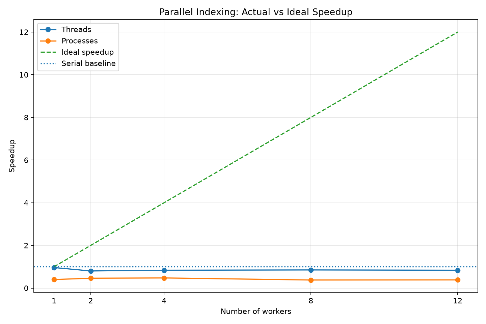

# Findex 0.7.0 — пошукова система на Python

[](https://github.com/marriavvella/findex/actions/workflows/ci.yml)

Навчальний проєкт Findex присвячений розробці пошукової системи з використанням Python. У межах лабораторних робіт досліджуються ітератори, генератори, обробка текстових корпусів, інвертовані індекси, структури даних, серіалізація та алгоритми пошуку.

## Лабораторна робота №1. Ітератори, генератори та ледачі пайплайни

Метою роботи є вивчення протоколу ітерації Python, генераторів, ледачих пайплайнів і методів обробки текстових даних.

### Корпус документів

Для дослідження використовується локальний корпус із 7 текстових документів у папці `data/`. Файли мають формат `.txt` та кодування UTF-8.

### Порівняння жадібної та ледачої обробки

| Версія | Документів | Пікова пам'ять | Час |
|---|---:|---:|---:|
| Жадібна (списки) | 7 | ≈145,20 МБ | ≈2,10 с |
| Ледача (генератори) | 7 | 19,57 МБ | 7,13 с |

Жадібна версія повністю завантажує документи в оперативну пам'ять, створюючи проміжні списки та інші об'єкти. Це забезпечує відносно швидке виконання, але збільшує використання пам'яті.

Ледача версія використовує генератори, `yield`, `iter_documents` та послідовну токенізацію. Документи обробляються поступово, що дозволяє суттєво скоротити пікове споживання пам'яті.

За результатами експерименту ледача обробка використала приблизно у 7,4 раза менше пам'яті, хоча виконувалася довше.

## Лабораторна робота №2. Інвертований індекс: словники, хешування та пам'ять

Метою роботи є дослідження структур даних Python, побудови інвертованого індексу, використання компактних структур зберігання, серіалізації та порівняння алгоритмів обробки постингів.

### Побудова інвертованого індексу

Реалізовано клас `InvertedIndex`, який обробляє текстові документи та формує інвертований індекс.

Для кожного терміна зберігаються ідентифікатори документів (`doc_ids`) та частоти його появи (`tfs`). Додатково зберігаються метадані документів і їхні довжини.

Результати індексації:

| Показник | Значення |
|---|---:|
| Кількість документів | 7 |
| Унікальні терміни | 26 034 |
| Загальна кількість токенів | 774 449 |
| Кількість постингів | 56 403 |
| Середня довжина документа | 110 635,57 токена |
| Час побудови індексу | 0,850 с |

### Порівняння структур зберігання даних

Для експерименту використано 10 000 цілих чисел. Порівнювалися звичайний список Python, компактний масив `array('I')` і масив NumPy.

| Структура | Використана пам'ять | Економія відносно списку |
|---|---:|---:|
| Python `list` | 360 056 байт | — |
| `array('I')` | 40 080 байт | 88,87% |
| NumPy `ndarray` | 40 112 байт | 88,86% |

Компактні типізовані масиви дозволили скоротити використання пам'яті приблизно на 89%. Вимірювання стосуються числових контейнерів, а не повного інвертованого індексу.

### Порівняння алгоритмів перетину постингів

Реалізовано два алгоритми:

- `set` — перетин множин Python.

- `merge` — двовказівниковий алгоритм перетину відсортованих списків.

Для перевірки використано постинги термінів `alice` і `wonderland`. Експеримент проведено з 1000 повтореннями.

| Алгоритм | Середній час |
|---|---:|
| `set` | 0,001450 мс |
| `merge` | 0,000343 мс |

У цьому експерименті `merge` виявився приблизно у 4,23 раза швидшим. Обидва алгоритми повернули однаковий результат.

Оскільки списки містили лише 3 та 1 документ, ці вимірювання не є достатніми для узагальнення продуктивності на великих наборах даних.

### Серіалізація індексу

Реалізовано збереження та завантаження інвертованого індексу у форматах Pickle і JSON.

| Показник | Pickle | JSON |
|---|---:|---:|
| Розмір файлу | 2 495 372 байт | 1 271 669 байт |
| Час збереження | 0,2896 с | 0,2311 с |
| Час завантаження | 0,1365 с | 0,1767 с |

JSON-файл виявився приблизно на 49,04% меншим за Pickle. У проведеному вимірюванні JSON швидше зберігався, а Pickle швидше завантажувався.

Ці результати отримані під час одного запуску експерименту.

### Командний інтерфейс

Реалізовано CLI на основі бібліотеки Typer.

Основні команди:

- `findex build` — побудова інвертованого індексу.

- `findex search` — пошук документів.

- `findex stats` — перегляд статистики індексу.

- `findex crawl` — асинхронний збір вебсторінок.

- `findex serve` — запуск вебсервера FastAPI.

Приклади використання:

```powershell

uv run findex build data --out index.pkl

uv run findex stats --index index.pkl

uv run findex search "wonderland" --index index.pkl

uv run findex search "alice AND wonderland" --index index.pkl

```

### Тестування

Для перевірки програми використовується `pytest`.

Запуск тестів:

```powershell

uv run pytest -v

```

Результат перевірки лабораторної №2: **7 тестів пройдено, 0 помилок, час виконання — 0,88 с**.

Перевірено побудову індексу, серіалізацію Pickle та JSON, базовий парсинг запитів і токенізацію.

### Файли експериментів

- `benchmark_memory.py` — порівняння використання пам'яті.

- `benchmark_serialization.py` — порівняння Pickle та JSON.

- `benchmark_intersection.py` — порівняння `set` і `merge`.

- `src/findex/index.py` — реалізація інвертованого індексу.

- `src/findex/query_parser.py` — розбір пошукових запитів.

- `src/findex/search.py` — виконання пошуку.

- `src/findex/cli.py` — командний інтерфейс.

### Висновки

У ході лабораторної роботи побудовано інвертований індекс для текстового корпусу, реалізовано його серіалізацію та досліджено особливості зберігання даних у пам'яті.

Експерименти показали, що компактні типізовані масиви значно зменшують витрати пам'яті порівняно зі звичайними списками Python. Також проведено порівняння алгоритмів перетину постингів і форматів серіалізації.

Отримані результати демонструють вплив вибору структур даних та алгоритмів на продуктивність пошукової системи.

## Лабораторна робота №3. Об'єктна модель Python та ранжування результатів пошуку

Метою лабораторної роботи є дослідження об'єктної моделі Python, спеціальних методів класів, реалізація алгоритмів ранжування пошукових результатів, кешування, профілювання та оцінювання якості інформаційного пошуку.

### Реалізація об'єктної моделі

У межах лабораторної роботи розширено клас `InvertedIndex` спеціальними методами Python:

- `__len__` — отримання кількості термінів в індексі.

- `__contains__` — перевірка наявності терміна.

- `__getitem__` — отримання постингів терміна.

- `__iter__` — ітерація за термінами індексу.

- `__repr__` — текстове представлення об'єкта.

- `__enter__` і `__exit__` — підтримка контекстного менеджера.

Додатково реалізовано властивості та методи для отримання статистичних характеристик індексу: `num_docs`, `avg_doc_length`, `doc_length()` і `df()`.

Під час перевірки отримано такі результати:

| Показник | Значення |
|---|---:|
| Кількість документів | 7 |
| Унікальні терміни | 26 034 |
| Середня довжина документа | 110 635,57 токена |
| Довжина документа №1 | 30 478 токенів |
| Частота документів для `alice` | 3 |

Реалізація спеціальних методів дозволила використовувати інвертований індекс як повноцінний об'єкт Python.

### Реалізація алгоритмів ранжування

Для визначення релевантності документів реалізовано два алгоритми ранжування: TF-IDF та BM25.

**TF-IDF** враховує частоту появи терміна в документі та його поширеність у всьому корпусі. Це дозволяє підвищувати оцінку документів, у яких пошукові терміни мають більшу значущість.

**BM25** додатково враховує довжину документа та використовує нормалізацію частоти термінів. Завдяки цьому алгоритм зменшує вплив надмірного повторення одного слова.

Обидва алгоритми реалізовано в модулі `src/findex/scoring.py`.

### Sanity-check перевірки ранжування

Для перевірки коректності роботи алгоритмів BM25 і TF-IDF проведено три контрольні перевірки на текстовому корпусі із семи документів.

**Перевірка 1. Пошуковий запит `alice`.**

Під час виконання пошуку з використанням алгоритму BM25 отримано такі результати:

| Місце | Документ | Оцінка BM25 |
|---|---|---:|
| 1 | Alice's Adventures in Wonderland | 2,0632 |
| 2 | The Adventures of Sherlock Holmes | 1,8394 |
| 3 | The Picture of Dorian Gray | 0,9291 |

Документ ***Alice's Adventures in Wonderland*** отримав найбільшу оцінку релевантності та посів перше місце. Це відповідає очікуваному результату, оскільки ім'я Alice безпосередньо пов'язане зі змістом твору.

**Перевірка 2. Пошуковий запит `wonderland`.**

Під час перевірки алгоритми BM25 і TF-IDF повернули документ №1 — ***Alice's Adventures in Wonderland***. Отриманий результат відповідає очікуваному, оскільки пошуковий термін входить до назви документа та пов'язаний із його тематикою.

**Перевірка 3. Пошуковий запит `rabbit`.**

Для запиту `rabbit` виконано порівняння результатів двох алгоритмів ранжування. Обидва алгоритми визначили документ ***Alice's Adventures in Wonderland*** як релевантний. За результатами ручного оцінювання Precision@5 для BM25 і TF-IDF становило 0,20.

Проведені контрольні перевірки підтвердили, що реалізовані алгоритми здатні знаходити тематично відповідні документи та формувати ранжований список результатів. Водночас порядок документів може відрізнятися залежно від використаної формули оцінювання релевантності.

### Обробка пошукових запитів

Розширено механізм обробки пошукових запитів. Реалізовано підтримку:

- Звичайних пошукових запитів.

- Булевих операторів `AND`, `OR`, `NOT`.

- Фразових запитів у лапках.

- Ранжування знайдених документів за оцінкою релевантності.

Для представлення структури запитів використовується синтаксичне дерево.

### Кешування та вимірювання часу виконання

Для оптимізації пошуку реалізовано кешування результатів із використанням `functools.lru_cache` з максимальним розміром 256 записів.

Повторне виконання однакового запиту дозволяє використовувати збережений результат замість повторного обчислення відповідної частини пошуку.

Для перевірки роботи кешу використовуються повідомлення `CACHE HIT` та `CACHE MISS`.

Також реалізовано декоратор `@timed`, який вимірює час виконання пошукової функції в мілісекундах.

Додатково реалізовано формування текстових фрагментів знайдених документів із виділенням пошукових термінів.

### Перевірка роботи LRU-кешування та декоратора `@timed`

Для перевірки механізму кешування виконано повторні пошукові запити.

Приклад діагностичного виведення для запиту `alice`:

```text

[CACHE MISS] alice

[LOG @timed] execute_search executed in 30.972 ms

[CACHE HIT] alice

[LOG @timed] execute_search executed in 22.259 ms

```

У наведеному прикладі перший запит потребував обчислення результату, а під час повторного виконання було використано кешовані дані.

Приклад для запиту `wonderland`:

```text

[CACHE MISS] wonderland

[LOG @timed] execute_search executed in 2.731 ms

[CACHE HIT] wonderland

[LOG @timed] execute_search executed in 2.170 ms

```

Приклад для точного фразового запиту:

```text

[CACHE MISS] "alice in wonderland"

[LOG @timed] execute_search executed in 21.541 ms

[CACHE HIT] "alice in wonderland"

[LOG @timed] execute_search executed in 0.067 ms

```

Повідомлення `CACHE MISS` означає, що результат відповідного запиту відсутній у кеші та потребує обчислення. Повідомлення `CACHE HIT` свідчить про повторне використання кешованого результату.

Декоратор `@timed` забезпечує автоматичне вимірювання тривалості виконання пошукової функції. Час залежить від складності запиту, кількості знайдених документів та інших операцій обробки результатів.

Наведені одиничні вимірювання не є універсальною оцінкою прискорення всієї пошукової системи.

### Оцінювання якості пошуку

Для оцінювання ефективності пошукової системи створено програму `evaluate_search.py`.

Дослідження проведено на корпусі із 7 текстових документів. Використано 10 пошукових запитів, для яких вручну визначено релевантні документи.

Для порівняння алгоритмів BM25 і TF-IDF використано метрику Precision@5.

Результати оцінювання:

| Пошуковий запит | BM25 | TF-IDF |
|---|---:|---:|
| `alice` | 0,20 | 0,20 |
| `wonderland` | 0,20 | 0,20 |
| `rabbit` | 0,20 | 0,20 |
| `queen` | 0,40 | 0,40 |
| `king` | 0,40 | 0,40 |
| `cat` | 0,20 | 0,20 |
| `garden` | 0,20 | 0,20 |
| `tea` | 0,20 | 0,20 |
| `alice AND rabbit` | 0,20 | 0,20 |
| `"alice in wonderland"` | 0,00 | 0,00 |
| **Середнє Precision@5** | **0,22** | **0,22** |

За результатами експерименту обидва алгоритми продемонстрували однакове середнє значення Precision@5 — 0,22.

Водночас порядок документів у результатах деяких запитів відрізнявся, що свідчить про різні принципи розрахунку оцінки релевантності.

Для точного фразового запиту `"alice in wonderland"` не було знайдено жодного документа.

Отримані результати залежать від невеликого корпусу, обраних запитів і ручних оцінок релевантності. Оскільки Precision@5 використовує фіксований знаменник 5, значення метрики також залежить від кількості релевантних документів у корпусі.

### Тестування

Для автоматизованої перевірки використано `pytest`.

Команда запуску:

```powershell

uv run pytest -v

```

За результатами останньої перевірки успішно пройдено **17 тестів без помилок**.

Перевірено об'єктну модель індексу, розбір пошукових запитів, алгоритми ранжування та механізм кешування.

### Основні файли лабораторної роботи

- `src/findex/index.py` — об'єктна модель інвертованого індексу.

- `src/findex/query_parser.py` — розбір булевих і фразових запитів.

- `src/findex/scoring.py` — алгоритми BM25 і TF-IDF.

- `src/findex/search.py` — пошук та ранжування документів.

- `src/findex/utils.py` — кешування, вимірювання часу й текстові фрагменти.

- `evaluate_search.py` — оцінювання якості пошуку.

- `evaluation_results.csv` — результати експерименту.

- `relevance_judgments.json` — ручні оцінки релевантності.

### Висновки

У ході лабораторної роботи розширено функціональність пошукової системи Findex шляхом реалізації спеціальних методів об'єктної моделі Python, алгоритмів ранжування TF-IDF і BM25, булевих та фразових запитів.

Додано механізм кешування LRU, вимірювання часу виконання пошуку та формування текстових фрагментів знайдених документів.

Проведено три контрольні sanity-check перевірки ранжування, які продемонстрували здатність пошукової системи знаходити тематично відповідні документи. Також перевірено механізм кешування за повідомленнями `CACHE HIT` і `CACHE MISS` та роботу декоратора `@timed`.

Проведено оцінювання якості пошуку на десяти запитах із використанням метрики Precision@5. Середнє значення для обох алгоритмів становило 0,22. Результати показали, що алгоритми можуть по-різному впорядковувати документи навіть за однакової точності на перших п'яти позиціях.

Автоматизоване тестування підтвердило працездатність реалізованих компонентів. Таким чином, пошукову систему доповнено засобами ранжування, оптимізації та оцінювання якості результатів.

**---**

## Лабораторна робота №4. Типізація, тестування, CLI та пакування

Метою лабораторної роботи є підвищення надійності пошукової системи Findex шляхом статичної типізації, автоматизованого тестування, налаштування безперервної інтеграції та підготовки Python-пакета до випуску.

### Статична типізація

Для перевірки типів використано Pyright у строгому режимі (`strict`).

Перевірка охоплює вихідний код у каталозі `src/`.

Команда запуску:

```powershell

uv run pyright

```

Результат перевірки:

```text

0 errors, 0 warnings, 0 informations

```

Для визначення інтерфейсу алгоритмів ранжування використано `Protocol`. Також застосовано анотації типів, `Iterator`, `Iterable` та `Literal` для уточнення контрактів функцій і параметрів.

### Автоматизоване тестування

Для перевірки коректності роботи програми використано бібліотеку `pytest`.

Тести охоплюють побудову інвертованого індексу, серіалізацію, токенізацію, пошук, алгоритми ранжування BM25 і TF-IDF, обробку запитів, кешування, CLI та інші компоненти системи.

Додатково застосовано бібліотеку Hypothesis для перевірки властивостей програмних компонентів.

Запуск усіх тестів:

```powershell

uv run pytest -v

```

Результат:

**70 тестів успішно пройдено, помилок немає.**

### Аналіз покриття коду

Для вимірювання покриття використано `pytest-cov`.

Команда:

```powershell

uv run pytest --cov=findex --cov-report=term-missing

```

Результати останньої перевірки:

| Показник | Значення |
|---|---:|
| Загальна кількість тестів | 70 |
| Успішних тестів | 70 |
| Загальне покриття | 86% |
| Покриття `index.py` | 100% |
| Покриття `tokenize.py` | 100% |
| Покриття `stats.py` | 98% |
| Покриття `scoring.py` | 93% |
| Покриття `cli.py` | 81% |

Отримані результати підтверджують, що основні компоненти пошукової системи охоплені автоматизованими перевірками.

### Перевірка багатопроцесорної індексації

Перевірено три способи побудови інвертованого індексу:

- Послідовна індексація (`serial`).

- Багатопотокова індексація (`threads`).

- Багатопроцесорна індексація (`processes`).

Усі відповідні тести успішно пройдено.

### Перевірка якості коду Ruff

Для статичного аналізу якості коду використано Ruff.

Команда запуску:

```powershell

uv run ruff check .

```

Результат:

```text

All checks passed!

```

Під час підготовки лабораторної роботи усунуто зауваження Ruff щодо оформлення коду, імпортів, обробки винятків, логування та використання сучасного синтаксису Python.

### Безперервна інтеграція GitHub Actions

Для автоматичної перевірки проєкту налаштовано workflow:

`.github/workflows/ci.yml`

Під час надсилання змін у гілку `lab-02-08` GitHub Actions автоматично:

1. Завантажує код репозиторію.

2. Налаштовує Python 3.12.

3. Встановлює менеджер пакетів `uv`.

4. Встановлює залежності проєкту.

5. Запускає Ruff.

6. Виконує перевірку типів Pyright.

7. Запускає Pytest із вимірюванням покриття.

Автоматична перевірка успішно завершилася на GitHub Actions для коміту `9934992`.

Стан перевірок відображається за допомогою CI-бейджа на початку README.

### Пакування та версія проєкту

Конфігурацію Python-пакета визначено у файлі `pyproject.toml`.

Назва пакета: `findex`.

Версія для лабораторної роботи №4: `0.4.0`.

Для збирання пакета використовується команда:

```powershell

uv build

```

У результаті успішно створено:

- `dist/findex-0.4.0-py3-none-any.whl`

- `dist/findex-0.4.0.tar.gz`

Командний інтерфейс доступний через точку входу:

```text

findex = "findex.cli:app"

```

### Встановлення та перевірка CLI

Для встановлення програми як окремої утиліти з каталогу проєкту використовується:

```powershell

uv tool install .

```

Результат встановлення:

```text

Installed 1 executable: findex

```

Для перевірки доступних команд:

```powershell

findex --help

```

Програма успішно запускається та підтримує команди `build`, `search`, `stats`, `crawl` і `serve`.

### Git-теги та реліз

Для позначення завершеної лабораторної роботи створено Git-теги:

- `lab-04`

- `v0.4.0`

Обидва теги вказують на коміт `9934992`.

Опубліковано GitHub Release:

[Findex v0.4.0 — Lab 4](https://github.com/marriavvella/findex/releases/tag/v0.4.0)

До релізу прикріплено готовий пакет:

`findex-0.4.0-py3-none-any.whl`

Пакет доступний для завантаження в розділі Assets на сторінці релізу.

### Висновки

У ході лабораторної роботи вдосконалено якість і надійність пошукової системи Findex. Проведено статичну перевірку типів у строгому режимі, розширено автоматизоване тестування та досягнуто загального покриття коду 86%.

Успішно виконано 70 тестів, а модуль побудови інвертованого індексу `index.py` охоплено тестами на 100%. Усі перевірки Ruff та Pyright завершилися без помилок.

Налаштовано GitHub Actions для автоматичного виконання перевірок на Linux. Підтверджено успішне збирання пакета версії `0.4.0`, встановлення CLI-утиліти через `uv tool install .` та запуск команди `findex --help`.

Створено й опубліковано реліз `v0.4.0` із готовим wheel-пакетом. Таким чином, реалізовано основні етапи типізації, тестування, контролю якості коду, безперервної інтеграції та пакування Python-проєкту.

## Лабораторна робота №5. Конкурентність і GIL: потоки, процеси та паралельна індексація

Метою лабораторної роботи є дослідження конкурентного виконання в Python, впливу глобального блокування інтерпретатора (GIL), використання потоків і процесів та продуктивності паралельної побудови інвертованого індексу.

### Реалізація паралельної індексації

Побудову індексу розділено на дві операції: `build_partial()` створює частковий індекс для визначеної групи файлів, а `merge()` об'єднує часткові результати в один інвертований індекс. Кожній групі документів призначаються наперед визначені діапазони `doc_id`, щоб уникнути конфліктів ідентифікаторів. Функції, які передаються робочим процесам, визначено на рівні модуля, що забезпечує можливість їх серіалізації для `ProcessPoolExecutor`.

Реалізовано `build_index_parallel()` із трьома режимами:

- `serial` — послідовна обробка;

- `threads` — паралельне виконання через `ThreadPoolExecutor`;

- `processes` — виконання через `ProcessPoolExecutor` із контекстом `spawn`, сумісним із Windows.

Для коректності передбачено передавання винятків із робочих завдань у головний потік виконання. Додаткові тести перевіряють, зокрема, відповідність результатів послідовної та паралельної побудови індексу.

У CLI додано параметри `--workers N` і `--executor {serial,threads,processes}` для команди індексації. Конкретні приклади синтаксису можна переглянути командою `findex index --help`.

### Умови експерименту

Бенчмарки проведено на локальному корпусі з **7 документів** (`data/`), що містить **26 034 унікальні терміни**. Процесор: **AMD64 Family 23 Model 104 Stepping 1, AuthenticAMD**, **12 логічних процесорів**. Для кожної конфігурації виконано **3 повторення**, а в таблицю внесено медіанні значення. Перевірено 1, 2, 4, 8 і 12 воркерів (для `serial` — один). Загалом виконано **33 вимірювання**.

Вимірювалися: повний час виконання (`wall time`), процесорний час батьківського процесу (`CPU time`), піковий RSS батьківського процесу та час об'єднання часткових індексів (`merge time`). Прискорення обчислювалося як відношення часу послідовного режиму до часу поточної конфігурації:

\[

S(N) = \frac{T_{serial}}{T_N}.

\]

**Обмеження методики:** `CPU time` і `RSS` відображають лише батьківський процес, а не сумарне використання ресурсів дочірніми процесами. Піковий RSS визначається періодичним опитуванням, тому короткочасні піки можуть бути пропущені.

### Результати бенчмарків

| Режим | Воркери | Wall, с | CPU, с | RSS, МБ | Merge, с | Speedup |
|---|---:|---:|---:|---:|---:|---:|
| serial | 1 | 0,739 | 0,406 | 108,9 | 0,174 | 1,000 |
| threads | 1 | 0,769 | 0,438 | 107,8 | 0,206 | 0,962 |
| threads | 2 | 0,922 | 0,516 | 116,7 | 0,293 | 0,802 |
| threads | 4 | 0,883 | 0,422 | 122,9 | 0,213 | 0,837 |
| threads | 8 | 0,870 | 0,469 | 122,7 | 0,215 | 0,850 |
| threads | 12 | 0,884 | 0,453 | 127,9 | 0,216 | 0,837 |
| processes | 1 | 1,848 | 0,172 | 116,3 | 0,189 | 0,400 |
| processes | 2 | 1,604 | 0,156 | 114,8 | 0,198 | 0,461 |
| processes | 4 | 1,558 | 0,156 | 114,2 | 0,235 | 0,475 |
| processes | 8 | 1,957 | 0,156 | 115,0 | 0,217 | 0,378 |
| processes | 12 | 1,932 | 0,234 | 114,5 | 0,233 | 0,383 |



Вихідні дані експерименту: [`benchmarks/results/parallel_benchmark.csv`](benchmarks/results/parallel_benchmark.csv). Скрипт для повторного запуску: [`benchmarks/benchmark_parallel.py`](benchmarks/benchmark_parallel.py).

Запуск бенчмарків у середовищі проєкту:

```powershell

uv run python benchmarks/benchmark_parallel.py data/

```

Найшвидшою на цьому корпусі була **послідовна індексація** (0,739 с). Серед процесних конфігурацій найкращий результат показали **4 воркери** (1,558 с), проте навіть він повільніший за послідовний режим. Збільшення кількості воркерів не гарантує прискорення через накладні витрати на створення та координацію виконавців, передавання результатів і об'єднання індексів. Для дослідженого малого корпусу доцільно залишити режим `serial` типовим.

### GIL, потоки, процеси та закон Амдала

**GIL (Global Interpreter Lock)** — механізм стандартної збірки CPython, який обмежує одночасне виконання Python-байткоду кількома потоками одного процесу. Для обчислювально інтенсивних операцій потоки зазвичай не дають лінійного прискорення, хоча можуть бути корисними під час очікування вводу-виводу. Окремі процеси мають власні інтерпретатори й можуть виконувати Python-код паралельно на різних ядрах, проте потребують додаткової пам'яті та витрат на запуск, серіалізацію й обмін даними.

У нашому експерименті на звичайній збірці Python потоки не перевершили `serial`. Процеси також не прискорили обробку через невеликий корпус і накладні витрати. Час `merge()` становив приблизно **0,174–0,293 с** залежно від конфігурації. Об'єднання результатів виконується після часткової індексації та залишається обмеженням масштабування.

За законом Амдала теоретичне прискорення обмежене часткою роботи, яку неможливо розпаралелити:

\[

S(N) = \frac{1}{(1-p)+p/N},

\]

де `p` — частка паралельної роботи, а `N` — кількість виконавців. Навіть за великої кількості воркерів послідовні етапи, зокрема `merge()`, не зникають. Виміряний час `merge()` не слід автоматично ототожнювати з точною часткою `(1-p)`: це лише одна зі складових накладних витрат і послідовної роботи.

### Експеримент із Python 3.13t без GIL

Для додаткової перевірки встановлено **CPython 3.13.15 experimental free-threading build** (`3.13t`). Після імпорту NumPy **2.5.5** та модулів індексації перевірка `sys._is_gil_enabled()` повернула **`False`**. Індексація семи документів у режимі `threads` успішно виконалася без GIL.

Для запуску без встановлення всіх необов'язкових залежностей проєкту використовувався вихідний код із `src/` через `PYTHONPATH`; основне середовище `.venv` залишилося незмінним. Повне встановлення проєкту на 3.13t блокувала залежність `pydantic-core` через несумісність її збірки з цією версією free-threaded Python, але модуль індексації працював окремо.

Медіани трьох повторень для потокового режиму:

| Воркери | Звичайний Python, с | Python 3.13t без GIL, с |
|---|---:|---:|
| 1 | 0,769 | 0,825 |
| 2 | 0,922 | 0,635 |
| 4 | 0,883 | 0,612 |
| 8 | 0,870 | 0,581 |

На Python 3.13t час індексації зменшився з **0,825 с** (1 воркер) до **0,581 с** (8 воркерів), що відповідає прискоренню приблизно **1,42 раза** відносно однопотокового запуску в тому самому середовищі. Це свідчить про користь паралельного виконання потоків для цієї реалізації без GIL. Водночас пряме порівняння двох колонок є орієнтовним: версії Python, NumPy та умови запуску відрізняються.

### Тестування та основні файли

Після змін у `src/findex/index.py` виконано:

```powershell

uv run pytest -q

```

Результат: **83 тести пройдено успішно**. Перевірка `uv run ruff check benchmarks/benchmark_parallel.py` також завершилася повідомленням **`All checks passed!`**. Ці результати стосуються виконаних локальних перевірок; остаточні перевірки всього проєкту та CI проводяться перед публікацією змін.

Основні файли лабораторної: `src/findex/index.py`, `src/findex/cli.py`, `tests/test_parallel.py`, `benchmarks/benchmark_parallel.py`, `benchmarks/results/parallel_benchmark.csv`, `benchmarks/results/parallel_speedup.png`.

### Висновки

У ході лабораторної роботи реалізовано послідовну, багатопотокову та багатопроцесорну побудову інвертованого індексу, додано об'єднання часткових результатів, параметри CLI та автоматизовані тести. Проведено 33 вимірювання продуктивності на корпусі із семи документів із фіксацією часу виконання, процесорного часу, пам'яті, часу `merge()` та прискорення.

Експерименти показали, що на невеликому корпусі звичайна послідовна індексація швидша за паралельні варіанти. Водночас запуск Python 3.13t із вимкненим GIL продемонстрував прискорення потокової індексації при збільшенні кількості воркерів. Отримані результати підтверджують, що ефективність паралелізму залежить від GIL, розміру завдання, накладних витрат і частки послідовних операцій.

**---**

## Лабораторна робота №6. Асинхронний краулер: asyncio

Метою лабораторної роботи є реалізація асинхронного збору вебсторінок за допомогою `asyncio`, дослідження конкурентного виконання мережевих запитів, дотримання правил доступу до вебресурсів і підготовка зібраних документів до індексації пошуковою системою Findex.

### Реалізація асинхронного краулера

У модулі `src/findex/crawler.py` реалізовано асинхронне завантаження сторінок через `httpx`, обробку HTML за допомогою `selectolax`, чергу адрес і групу робочих завдань `asyncio.TaskGroup`. Краулер збирає посилання з HTML-сторінок, нормалізує URL і уникає повторного обходу вже відомих адрес. Під час нормалізації враховуються регістр схеми та хоста, фрагменти URL, слеші в шляху й порядок параметрів запиту.

Кількість одночасних запитів обмежується глобально та окремо для кожного хоста. Додатково можна встановити мінімальну затримку між зверненнями до хоста. Параметр `--max-pages` обмежує кількість зібраних сторінок.

### Етичний обхід і правила доступу

Краулер призначений для **локального тестового сервера або вебресурсів, на обхід яких отримано дозвіл**. Перед запуском на сторонньому сайті необхідно перевірити умови використання, правила `robots.txt` і допустиме навантаження. Для мережевих запитів слід використовувати чесний `User-Agent` із контактною інформацією оператора. Не можна обходити обмеження доступу, авторизацію або заборони власника ресурсу.

Реалізовано кешування `robots.txt` за хостом. Якщо правила забороняють обхід адреси, краулер не повинен її завантажувати. Для контрольованого навантаження використовуються параметри `--concurrency`, `--per-host-concurrency` і `--host-delay`. Для реальних сайтів доцільно встановлювати невелику паралельність і ненульову затримку; значення з бенчмарків нижче призначені лише для локального сервера.

### Обробка помилок і журналювання

Для запитів передбачено тайм-аут, обмежені повторні спроби з експоненційною затримкою та випадковим відхиленням (jitter). Повторні спроби використовуються для тимчасових збоїв, зокрема HTTP 429, серверних помилок і тайм-аутів; за наявності заголовка `Retry-After` він враховується. Звичайні клієнтські помилки HTTP 4xx не повинні спричиняти повторних запитів, окрім спеціально оброблюваного 429.

Для кожного звернення журналюються URL, HTTP-статус, обсяг отриманих даних і тривалість запиту. Під час виконання Rich Live відображає кількість сторінок, час, швидкість, активні запити, розмір черги та кількість помилок. Журнал можна зберегти параметром `--log-file`.

### Запуск на локальному тестовому сайті

Для відтворення експерименту використано локальний тестовий сайт `benchmark_site` із 220 HTML-сторінками та дозволом на обхід у `robots.txt`. У першому терміналі запускається HTTP-сервер:

```powershell

uv run python -m http.server 8000 --directory benchmark_site

```

У другому терміналі виконується краулер (приклад для 200 сторінок і паралельності 5):

```powershell

uv run findex crawl http\://127.0.0.1:8000/page1.html --out benchmark_c5.jsonl --max-pages 200 --concurrency 5 --per-host-concurrency 5 --host-delay 0 --log-file benchmark_c5.log

```

Вихідні дані зберігаються у форматі JSONL: один документ на рядок. Функція `iter_documents` у `src/findex/corpus.py` підтримує читання JSONL для подальшої індексації.

### Індексація результатів краулера

Зібрані сторінки можна індексувати окремою синхронною командою, після завершення асинхронного обходу:

```powershell

uv run findex index benchmark_c5.jsonl --out benchmark_index.pkl

```

Під час перевірки успішно побудовано індекс для **200 документів** із **14 унікальними термінами**. Час побудови індексу становив приблизно **0,192 с**. Індексація виконується поза циклом подій `asyncio`, щоб не блокувати асинхронні мережеві завдання.

### Результати бенчмарків

Для однакових 200 сторінок локального сервера проведено три запуски з паралельністю 1, 5 і 20. В усіх конфігураціях встановлено `--host-delay 0`, а ліміт запитів на хост дорівнював загальній паралельності.

| Concurrency | Сторінок | Час краулера, с | Швидкість, стор./с | Помилки | Оцінка пам'яті, MiB |
|---|---:|---:|---:|---:|---:|
| 1 | 200 | 3,11 | 64,31 | 0 | 20,46 |
| 5 | 200 | 2,76 | 72,21 | 0 | 20,49 |
| 20 | 200 | 2,74 | 72,94 | 0 | 20,47 |

**Обмеження вимірювання пам'яті:** значення отримані періодичним опитуванням процесів засобами PowerShell. Це приблизна оцінка найбільшого спостереженого використання пам'яті окремим процесом, **а не достовірний Peak RSS Python-краулера або сумарна пам'ять дерева процесів**. Короткочасні піки могли залишитися непоміченими. Час запуску процесу та роботи вимірювача не включено до наведеної тривалості самого краулера.

Підвищення паралельності з 1 до 5 дало помітне прискорення, тоді як перехід від 5 до 20 майже не змінив швидкість. На цьому локальному наборі даних паралельність 5 є розумним компромісом. Ці результати не можна автоматично переносити на зовнішні вебсайти або інші мережеві умови.

### Автоматизоване тестування та перевірка якості

Тести краулера використовують `httpx.MockTransport`, тому для їх виконання не потрібні запити до зовнішніх сайтів. Перевіряються, зокрема, нормалізація URL, правила `robots.txt`, обробка HTTP-відповідей і робота асинхронного обходу.

```powershell

uv run pytest -q

uv run ruff check .

uv run pyright

```

Під час локальної перевірки отримано **87 успішних тестів**, Ruff повідомив `All checks passed!`, а Pyright — `0 errors, 0 warnings, 0 informations`.

### Основні файли лабораторної роботи

- `src/findex/crawler.py` — асинхронний краулер, завантаження сторінок і обмеження запитів.

- `src/findex/cli.py` — команда `findex crawl`, виведення статистики й журналювання.

- `src/findex/corpus.py` — читання документів із JSONL.

- `benchmark_site/` — локальний тестовий сайт (за наявності в репозиторії).

- `benchmark_c1_new.log`, `benchmark_c5.log`, `benchmark_c20.log` — журнали запусків (за умови включення до репозиторію).

### Висновки

У лабораторній роботі реалізовано асинхронний краулер на основі `asyncio`, `httpx` і `TaskGroup`. Додано керування конкурентністю, кешування правил `robots.txt`, нормалізацію URL, обмеження кількості сторінок, повторні спроби для тимчасових помилок, журналювання та відображення статистики в реальному часі. Зібрані дані зберігаються у форматі JSONL і можуть бути проіндексовані пошуковою системою Findex.

Під час експериментів на локальному сервері в усіх трьох режимах успішно зібрано 200 сторінок без помилок. Збільшення паралельності до 5 підвищило швидкість обходу, проте подальше збільшення до 20 дало мінімальний додатковий ефект. Отримані результати підтверджують важливість налаштування конкурентності з урахуванням характеристик сервера та правил етичного вебсканування.
---

## Лабораторна робота №7. Вебсервіс пошукової системи, API та розгортання

Метою лабораторної роботи є перетворення пошукової системи Findex на вебзастосунок, доступний через браузер і HTTP API. Для цього реалізовано вебінтерфейс пошуку, серверні маршрути для отримання результатів і статистики, перевірку працездатності сервісу, контейнеризацію за допомогою Docker та підготовку до розгортання на Render.

### Запуск вебсервера

Для запуску проєкту необхідно встановити залежності та вказати шлях до збереженого індексу. У PowerShell команди виконуються з кореневої папки репозиторію:

```powershell
uv sync
$env:INDEX_PATH="index.pkl"
uv run findex serve --port 8000 --workers 1
```

Після запуску вебсервіс доступний локально за адресою `http://127.0.0.1:8000/`. Головна сторінка містить вебінтерфейс пошуку. Документація API Swagger UI доступна за адресою `http://127.0.0.1:8000/docs`.

Для коректної роботи сервера файл індексу має існувати за шляхом, указаним у змінній середовища `INDEX_PATH`. Якщо індекс збережено в іншому місці або він має іншу назву, необхідно вказати відповідний шлях.

### Реалізовані HTTP-маршрути

Вебсервіс надає маршрути для пошуку документів, перегляду окремого документа, отримання статистики та перевірки стану сервера.

| Маршрут | Призначення |
|---|---|
| `GET /` | Відкриття вебінтерфейсу пошукової системи |
| `GET /search` | Виконання пошукового запиту та повернення ранжованих результатів |
| `GET /docs/{doc_id}` | Отримання документа за його ідентифікатором |
| `GET /stats` | Отримання статистики індексу |
| `GET /health` | Перевірка працездатності вебсервісу |
| `GET /docs` | Відкриття інтерактивної документації Swagger UI |

Приклад запиту до пошукового API:

```text
GET /search?q=python&k=5&scorer=bm25&page=1
```

У запиті `q` задає пошукову фразу, `k` — кількість результатів, `scorer` — алгоритм ранжування, а `page` — номер сторінки результатів. Для наведеного прикладу використовується алгоритм BM25 і повертається перша сторінка з п'ятьма результатами.

### Перевірка API та працездатності сервера

Для перевірки роботи вебсервісу можна відкрити Swagger UI за адресою `http://127.0.0.1:8000/docs` і виконати доступні запити безпосередньо з браузера. Окремо перевіряються пошук за запитом, отримання документа, статистика індексу та маршрут `/health`.

Маршрут `/health` призначений для перевірки доступності сервера. Він також використовується платформою Render під час контролю стану розгорнутого застосунку.

### Автоматизоване тестування вебчастини

Для перевірки вебмаршрутів передбачено окремий набір тестів:

```powershell
uv run pytest tests/test_web.py -q
```

Ця команда запускає тести вебчастини. Для повної перевірки проєкту додатково можна виконати загальний набір тестів:

```powershell
uv run pytest -q
```

Результати тестування слід фіксувати за фактичним виведенням команд. Кількість успішних тестів для вебчастини не вказується наперед, оскільки вона має відповідати результату реального запуску.

### Контейнеризація за допомогою Docker

Для підготовки вебсервісу до запуску в контейнері використовується `Dockerfile`. Створення образу:

```powershell
docker build -t findex:0.7.0 .
```

Запуск контейнера:

```powershell
docker run --rm -p 8000:8000 -e INDEX_PATH=/app/index.pkl findex:0.7.0
```

Параметр `-p 8000:8000` відкриває порт вебсервера контейнера на локальному комп'ютері. Змінна `INDEX_PATH` указує шлях до індексу всередині контейнера. Тому файл `index.pkl` має бути включений до образу або доступний контейнеру іншим налаштованим способом. Саме створення Docker-образу не гарантує наявності індексу всередині контейнера.

### Підготовка до розгортання на Render

Для розгортання вебсервісу передбачено конфігурацію `render.yaml`. На платформі Render потрібно створити новий Blueprint, підключити GitHub-репозиторій і застосувати описану конфігурацію. Після завершення розгортання Render надає публічну адресу застосунку.

Після успішного деплою необхідно відкрити отриманий URL, перевірити головну сторінку, виконання пошуку та маршрут `/health`. Фактичну публічну адресу слід вписати в цей README лише після успішного розгортання. До цього моменту статус публікації — очікує деплою.

### Навантажувальне тестування

Для вимірювання продуктивності HTTP-сервісу використано утиліту `oha`. Вона надсилає серію HTTP-запитів і збирає статистику часу відповіді, пропускної здатності та обсягу переданих даних.

За наданим результатом запуску отримано такі показники:

| Показник | Результат |
|---|---:|
| Успішність запитів | 100,00% |
| Загальний час тесту | 7 370,1688 мс |
| Найшвидша відповідь | 669,4920 мс |
| Найповільніша відповідь | 879,3976 мс |
| Середній час відповіді | 736,5778 мс |
| Пропускна здатність | 27,1364 запитів/с |
| Загальний обсяг переданих даних | 307,03 KiB |
| Середній розмір відповіді | 1,54 KiB |
| Швидкість передавання даних | 41,66 KiB/с |

У цьому запуску всі запити завершилися успішно, тобто зафіксований відсоток успішності становив 100%. Середній час відповіді дорівнював приблизно 736,58 мс, а сервер обробляв у середньому 27,14 запиту за секунду. Різниця між найшвидшою та найповільнішою відповідями показує розкид часу обробки запитів у межах цього конкретного тесту.

Ці показники характеризують лише умови проведеного запуску: конфігурацію комп'ютера, локальне або мережеве середовище, параметри навантаження та поточний стан сервера. Їх не слід трактувати як гарантовану продуктивність розгорнутого сервісу для будь-якої кількості користувачів.

Повний звіт навантажувального тестування з параметрами запуску та додатковими результатами зберігається у файлі `benchmarks/lab07_oha.md`. Значення в цьому розділі потрібно змінювати лише після повторного фактичного вимірювання.

### Основні файли лабораторної роботи

- `src/findex/` — програмні модулі пошукової системи та вебсервісу.
- `src/findex/cli.py` — командний інтерфейс і команда `findex serve`.
- `index.pkl` — збережений інвертований індекс, який використовує вебсервіс.
- `tests/test_web.py` — автоматизовані тести вебмаршрутів.
- `Dockerfile` — інструкції для створення Docker-образу.
- `render.yaml` — конфігурація розгортання на Render.
- `benchmarks/lab07_oha.md` — звіт навантажувального тестування за допомогою `oha`.

### Висновки

У ході лабораторної роботи пошукову систему Findex підготовлено до використання як вебзастосунку. Передбачено запуск вебсервера, доступ до пошукового інтерфейсу через браузер та взаємодію із системою через HTTP API. Реалізовані маршрути дають змогу виконувати пошук, отримувати документи, переглядати статистику індексу й перевіряти працездатність сервера.

Окремо передбачено автоматизовану перевірку вебчастини, створення Docker-образу та конфігурацію для розгортання на Render. Навантажувальне тестування показало 100% успішних запитів у проведеному запуску, середній час відповіді близько 736,58 мс і пропускну здатність близько 27,14 запиту за секунду. Отримані результати підтверджують працездатність сервісу в межах перевіреного сценарію. Остаточну доступність системи в інтернеті можна підтвердити після успішного розгортання на Render і перевірки публічної адреси.
